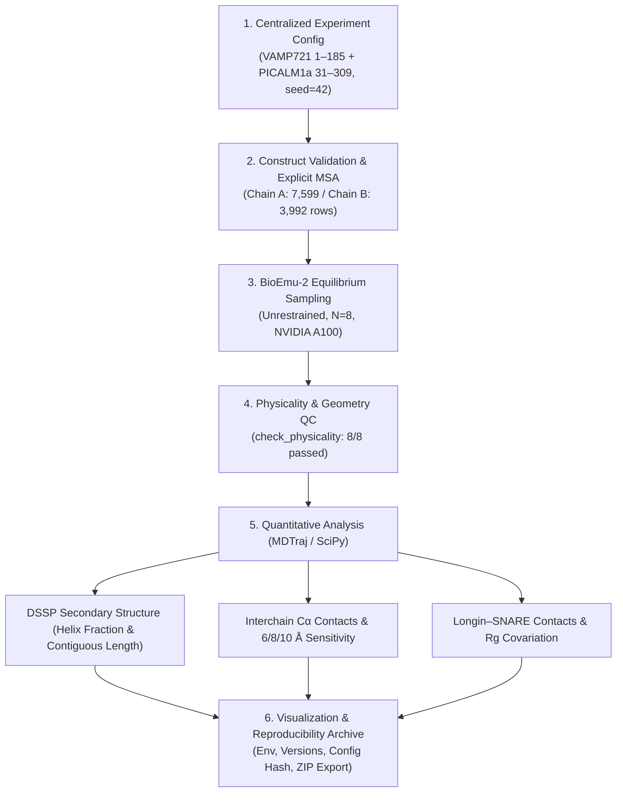
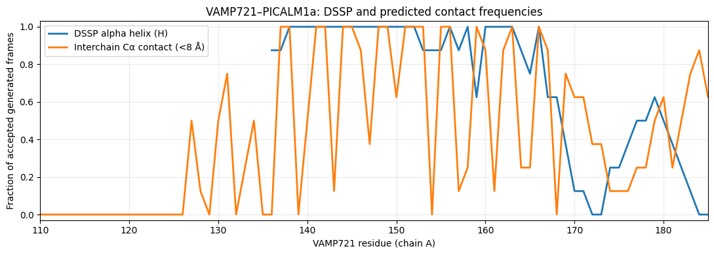
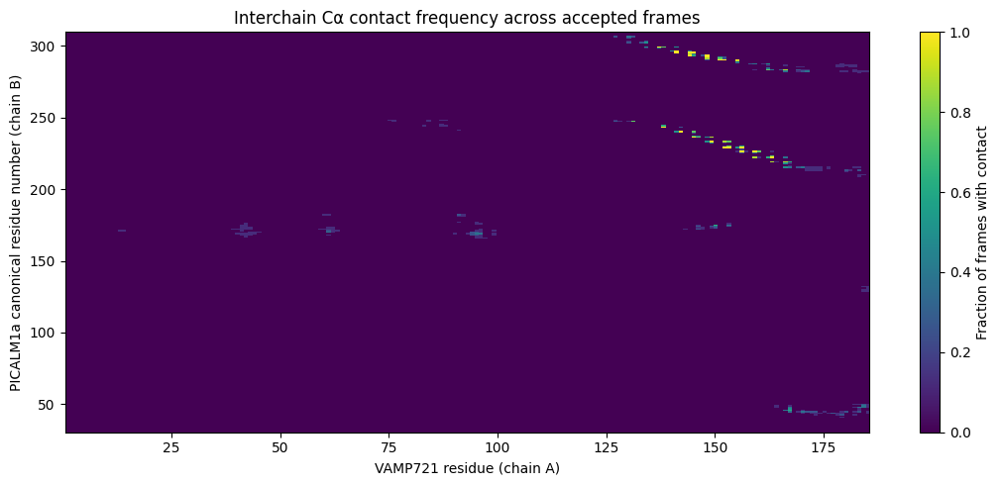
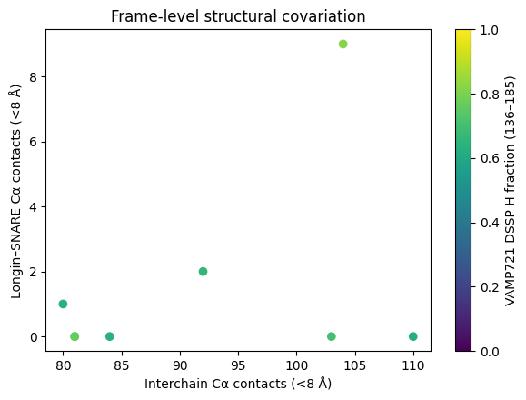

# VAMP721–PICALM1a Structural Ensemble Analysis (BioEmu-2)

[日本語](README.md) | English

**A reproducible Python structural bioinformatics pipeline using BioEmu-2 to explore conformational ensembles of a protein complex with quantitative geometry, secondary-structure, and interface analyses.**

Motivated by experimental evidence linking plant PICALM1a/1b to VAMP72 SNARE retrieval (Fujimoto et al., *PNAS*, 2020), this notebook builds an end-to-end computational workflow using [BioEmu-2](https://github.com/microsoft/bioemu2) (`equilibrium` mode, without contact restraints) followed by physicality QC (`check_physicality`), MDTraj DSSP secondary-structure quantification, `SciPy cKDTree` interchain/intradomain contact analysis, cutoff sensitivity analysis, and reproducibility metadata archiving.

---

## 1. Workflow Architecture

---

## 2. Experiment Summary & Quantitative Results

Notebook: [VAMP721_PICALM1a_BioEmu2_Complex_Equilibrium_学習版_v2.ipynb](VAMP721_PICALM1a_BioEmu2_Complex_Equilibrium_%E5%AD%A6%E7%BF%92%E7%89%88_v2.ipynb)

| Item | Configuration / Observation |
| :--- | :--- |
| **Target Complex** | Chain A: VAMP721 (`WT 1–185`, 185 aa) / Chain B: PICALM1a (`ANTH 31–309`, 279 aa) — 464 residues, 3,736 atoms |
| **Runtime** | `bioemu2 0.1.0rc0`, `PyTorch 2.13.0+cu130`, NVIDIA A100-SXM4-40GB (Google Colab) |
| **Sampling Setup** | `mode="equilibrium"`, `N=8`, `seed=42`, unrestrained (`contacts conditioned: False`), explicit MSA |
| **Physicality QC** | `check_physicality` passed: **8 / 8 frames** |
| **VAMP721 SNARE (136–185) DSSP `H` Fraction** | **Mean 70.2%** (median 68.0%, range 62.0%–82.0%) |
| **Longest Contiguous α-Helix** | `[23, 33, 21, 23, 29, 31, 23, 15]` residues (**8 / 8** frames ≥ 10 residues) |
| **Interchain Cα Contact Pairs (< 8 Å)** | `[84, 104, 103, 92, 81, 110, 81, 80]` pairs per frame (with 6 / 8 / 10 Å sensitivity checks) |
| **VAMP721-only Radius of Gyration ($R_g$)** | Mean **26.25 Å** |

> **Exploratory Reference Comparison**: In a prior VAMP721-only `equilibrium` run (100 frames), the DSSP `H` fraction across residues 136–185 was **9.1%**, compared with **70.2%** across the 8 complex frames here (reference difference `+61.1%`). Because sample sizes and run settings differ, this is strictly an exploratory observation rather than an estimate of in-vivo binding thermodynamics.

---

## 3. Key Visualizations

### 1. SNARE α-Helix Frequency and Interchain Contact Profile

Across VAMP721 residues 136–166, high DSSP `H` (α-helix) occupancy co-occurs with periodic interchain Cα contacts (< 8 Å).

### 2. 2D Interchain Interface Contact Map

Residue-pair contact frequencies across all accepted frames (with PICALM1a indices mapped back to canonical residue numbers) highlight recurring candidate interface bands.

### 3. Frame-Level Structural Covariation

Joint distribution of interchain Cα contacts, intrachain Longin (1–110)–SNARE contacts, and SNARE α-helix fraction per frame. This captures ensemble covariation only and does not imply binding order or kinetics.

---

## 4. Data Science & Reproducibility Highlights

- **Construct & Index Verification**: Programmatically verifies sequence differences across candidate constructs and maps PICALM1a fragment indices back to canonical numbering.
- **Threshold Sensitivity Analysis**: Evaluates interchain Cα contact distributions across **6 Å, 8 Å, and 10 Å** cutoffs rather than relying on a single arbitrary threshold.
- **Modular Optional Metrics**: Exposes buried-interface SASA calculations via an explicit configuration flag (`RUN_OPTIONAL_SASA`) to separate fast verification runs from extended analyses.
- **Full Provenance Packaging**: Exports environment info, package versions, configuration hashes, quantitative tables, and structural outputs into a reproducible ZIP archive.

---

## 5. Scientific Scope & Limitations

- BioEmu-2 frames represent independent conformational samples, not physical molecular-dynamics trajectories; sampling frequencies cannot directly determine equilibrium populations, binding affinity ($K_d$), pathways, or free energies.
- Next computational steps include scaling to 50–100 structures across multiple independent random seeds and running matched monomer vs. complex controls under identical settings.
- Confirming actual binding, helix stabilization, and interface geometry requires independent biophysical experiments (e.g., SPR, CD, FRET, NMR, HS-AFM, or complex SAXS).

---

## 6. Tech Stack

- **Environment**: Python 3.13, Jupyter Notebook, Google Colab (CUDA / GPU)
- **Structural Biology & AI**: BioEmu-2, PyTorch, MDTraj (DSSP / SASA / $R_g$), py3Dmol
- **Data Analysis & Plotting**: NumPy, pandas, SciPy (`cKDTree`), Matplotlib

## References
- Fujimoto et al., *PNAS* (2020), PMID: [32968023](https://pubmed.ncbi.nlm.nih.gov/32968023/)
- [BioEmu-2 Official Repository](https://github.com/microsoft/bioemu2)
