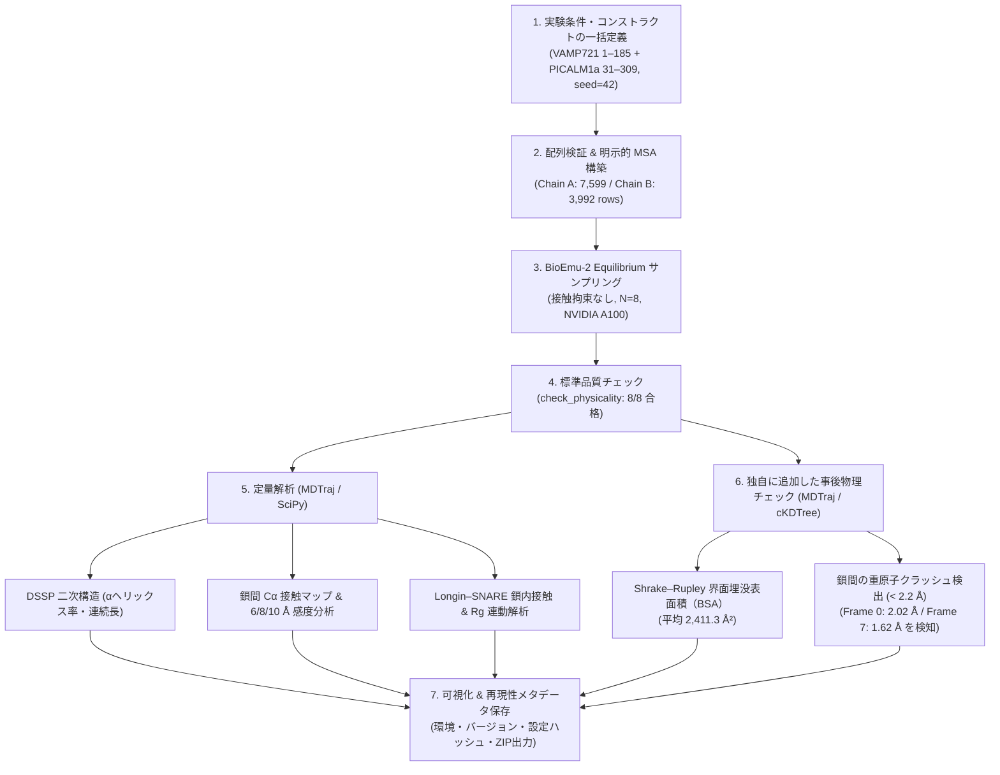
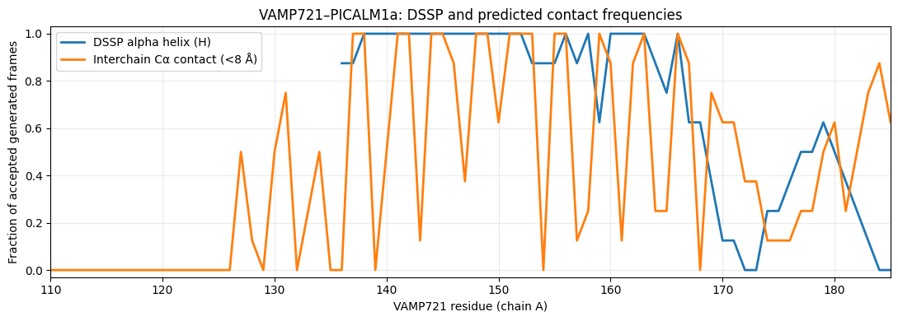
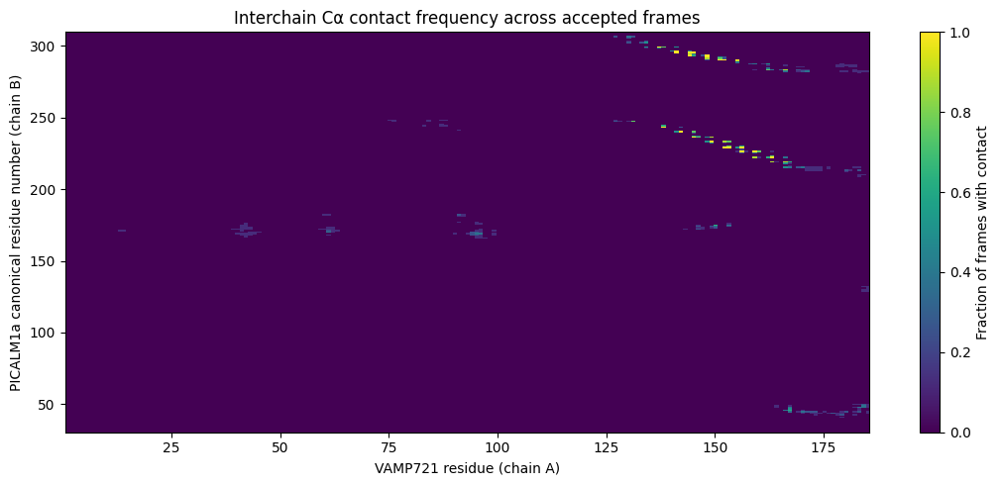
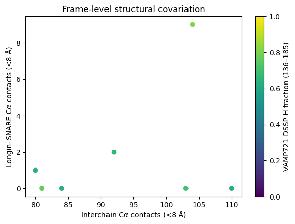

# VAMP721–PICALM1a Structural Ensemble Analysis (BioEmu-2)

日本語 | [English](README.en.md)

[](https://colab.research.google.com/github/Shunsuke-max/vamp721-structural-ensemble/blob/main/VAMP721_PICALM1a_BioEmu2_Complex_Equilibrium_%E5%AD%A6%E7%BF%92%E7%89%88_v2.ipynb)
[](https://github.com/Shunsuke-max/vamp721-structural-ensemble/actions/workflows/ci.yml)

**拡散モデル（BioEmu-2）でタンパク質複合体がとり得る複数の立体構造（配座アンサンブル）を探索し、独自の立体衝突チェック・距離条件の感度分析・テスト済み Python モジュールまで一貫して組んだ解析パイプラインです。**

植物のエンドサイトーシスに関わる VAMP721 と PICALM1a の複合体形成に着目し（Fujimoto et al., *PNAS*, 2020）、[BioEmu-2](https://github.com/microsoft/bioemu2) の `equilibrium` モードによる拘束なしの構造サンプリングを行いました。標準品質チェック（`check_physicality`）、DSSP 二次構造定量、`SciPy cKDTree` による鎖間接触・感度分析に加え、**標準品質チェック通過後の構造に対する独自の立体衝突（クラッシュ）検出と界面埋没表面積（BSA）評価**まで一貫実装しています。

> **データサイエンス上のハイライト**
> * **標準品質チェックを鵜呑みにしない独立検証**：BioEmu-2 の標準品質チェック（`check_physicality`）では **8/8 合格**となりましたが、独自に `SciPy cKDTree` で異なる鎖どうしの重原子距離（2.2 Å 未満）を調べたところ、**2 フレーム（Frame 0: 2.02 Å、Frame 7: 1.62 Å）に局所的な立体衝突（クラッシュ）が残っていること**を特定しました。
> * **単一の距離基準に頼らない感度分析**：鎖間 Cα 接触を 8 Å だけでなく **6 Å / 8 Å / 10 Å** の 3 条件で横断検証し、傾向の頑健さを確認しています。
> * **ノートブック止まりにしない再利用・テスト設計**：中核の数値指標と立体衝突（クラッシュ）検出ロジックを型付き Python モジュール（`src/ensemble_metrics.py`）へ切り出し、`pytest`・`ruff` と GitHub Actions CI で自動検証しています。

---

## 1. 解析パイプラインの全体像



---

## 2. 実験条件と実行結果サマリー

実行済みノートブック：[VAMP721_PICALM1a_BioEmu2_Complex_Equilibrium_学習版_v2.ipynb](VAMP721_PICALM1a_BioEmu2_Complex_Equilibrium_%E5%AD%A6%E7%BF%92%E7%89%88_v2.ipynb)

| 項目 | 設定・観測結果 |
| :--- | :--- |
| **対象複合体** | Chain A: VAMP721 (`WT 1–185`, 185 aa) / Chain B: PICALM1a (`ANTH 31–309`, 279 aa) — 計 464 残基・3,736 原子 |
| **モデル・実行環境** | `bioemu2 0.1.0rc0`, `PyTorch 2.13.0+cu130`, NVIDIA A100-SXM4-40GB (Google Colab) |
| **サンプリング設定** | `mode="equilibrium"`, `N=8`, `seed=42`, 事前接触拘束なし, 明示的 MSA 使用 |
| **標準品質チェック** | `check_physicality` 合格：**8 / 8 フレーム** |
| **独自の事後物理チェック（重原子 < 2.2 Å）** | 2 件の局所クラッシュを検知：**Frame 0** (`A179.O–B282.OE1: 2.02 Å`)、**Frame 7** (`A176.CE1–B48.CE: 1.62 Å`) |
| **界面埋没表面積（片側 BSA）** | **平均 2,411.3 Ų**（範囲 2,234.6–2,566.1 Ų、`Shrake–Rupley n_sphere_points=200`） |
| **VAMP721 SNARE領域 (136–185) DSSP `H` 率** | **平均 70.2%**（中央値 68.0%、範囲 62.0%–82.0%） |
| **最長連続 αヘリックス長** | `[23, 33, 21, 23, 29, 31, 23, 15]` 残基（**8 / 8** フレームで 10 残基以上） |
| **鎖間 Cα 接触ペア数 (< 8 Å)** | `[84, 104, 103, 92, 81, 110, 81, 80]` ペア（6 Å / 8 Å / 10 Å の感度分析も実施） |
| **VAMP721 単独 Rg（回転半径）** | 平均 **26.25 Å** |

> **単独計算との参考比較**：同一領域（VAMP721 136–185）の事前計算（単独 `equilibrium` 100 構造）における DSSP `H` 率は **9.1%**、今回の複合体 8 構造では **70.2%**（参考差 `+61.1%`）でした。ただしサンプル数・実行条件が異なる探索的な比較であり、生体内での結合効果や自由エネルギーを推定するものではありません。

---

## 3. 主要な可視化結果

### ① SNARE 領域の αヘリックス形成率と鎖間接触頻度


VAMP721 の SNARE 領域（136–166 残基付近）において、高い αヘリックス形成頻度（DSSP `H`）と、周期的な鎖間 Cα 接触（< 8 Å）の重なりが観察されました。

### ② 結合界面の 2 次元コンタクトマップ


全合格フレームを通じた残基ペアごとの接触頻度（PICALM1a 側は天然配列の残基番号へ変換済み）を可視化し、繰り返し現れる界面候補領域を定量的に把握できるようにしています。

### ③ 鎖間接触数と Longin–SNARE 鎖内接触のフレームごとの連動傾向


鎖間接触数（横軸）、VAMP721 の Longin（1–110）–SNARE 間の鎖内接触数（縦軸）、および SNARE の αヘリックス率（色）をフレーム単位で同時プロットしています（構造群内の相関観察に限定し、結合順序や因果関係は仮定していません）。

---

## 4. リポジトリ構成とテスト実行

```text
vamp721-structural-ensemble/
├── VAMP721_PICALM1a_BioEmu2_Complex_Equilibrium_学習版_v2.ipynb  # A100 実行済み解析ノートブック
├── src/
│   └── ensemble_metrics.py          # 再利用可能な定量解析・独自クラッシュ検査モジュール
├── tests/
│   └── test_ensemble_metrics.py     # pytest ユニットテスト（境界値・単調性・距離検証）
├── assets/                          # 実行結果から抽出した可視化プロット 3 点
├── .github/workflows/ci.yml         # Python 3.11 / 3.12 での ruff & pytest 自動 CI
└── pyproject.toml                   # パッケージ・依存関係定義
```

### ローカルでの lint・テスト実行

```bash
pip install -e ".[dev]"
ruff check src tests
pytest -v
```

---

## 5. 科学的スコープと検証の前提

本リポジトリは、**文献の事実・AI による構造候補の生成・今後実験で確かめるべき仮説**を明確に区別して設計しています。

* BioEmu-2 が生成するフレームは独立した構造候補であり、物理的な時間発展（分子動力学の軌跡）ではありません。出現頻度から生体内の平衡存在比・結合親和性（$K_d$）・結合経路・自由エネルギーを直接決めることはできません。
* 独自の立体衝突（クラッシュ）検査で 2 フレームに局所的な衝突（1.62 Å, 2.02 Å）が見つかった通り、標準品質チェック（`check_physicality`）だけでは物理的妥当性を完全には保証できません。後続の解析や構造緩和（エネルギー最小化）の前に、独立した品質チェックを挟むことが不可欠です。
* 今後の計算上の拡張としては、同条件でのサンプル数拡大（50–100 構造）、独立シード間の再現性評価、単独系と複合体系の完全同条件比較が挙げられます。
* 実際の結合有無・二次構造変化・界面の妥当性の実証には、SPR / CD / FRET / NMR / HS-AFM / 複合体 SAXS などの独立した実験検証が必要です。

---

## 6. 技術スタック・参考文献

- **言語・検証環境**：Python 3.10+ (Colab 実行時は Python 3.13 / CUDA GPU), Jupyter Notebook, pytest, GitHub Actions
- **構造生成・分子解析**：BioEmu-2, PyTorch, MDTraj (DSSP / Shrake–Rupley SASA / $R_g$), py3Dmol
- **数値計算・可視化**：NumPy, pandas, SciPy (`cKDTree`), Matplotlib
- **参考文献**：Fujimoto et al., *PNAS* (2020), PMID: [32968023](https://pubmed.ncbi.nlm.nih.gov/32968023/) / [BioEmu-2 Official Repository](https://github.com/microsoft/bioemu2)
