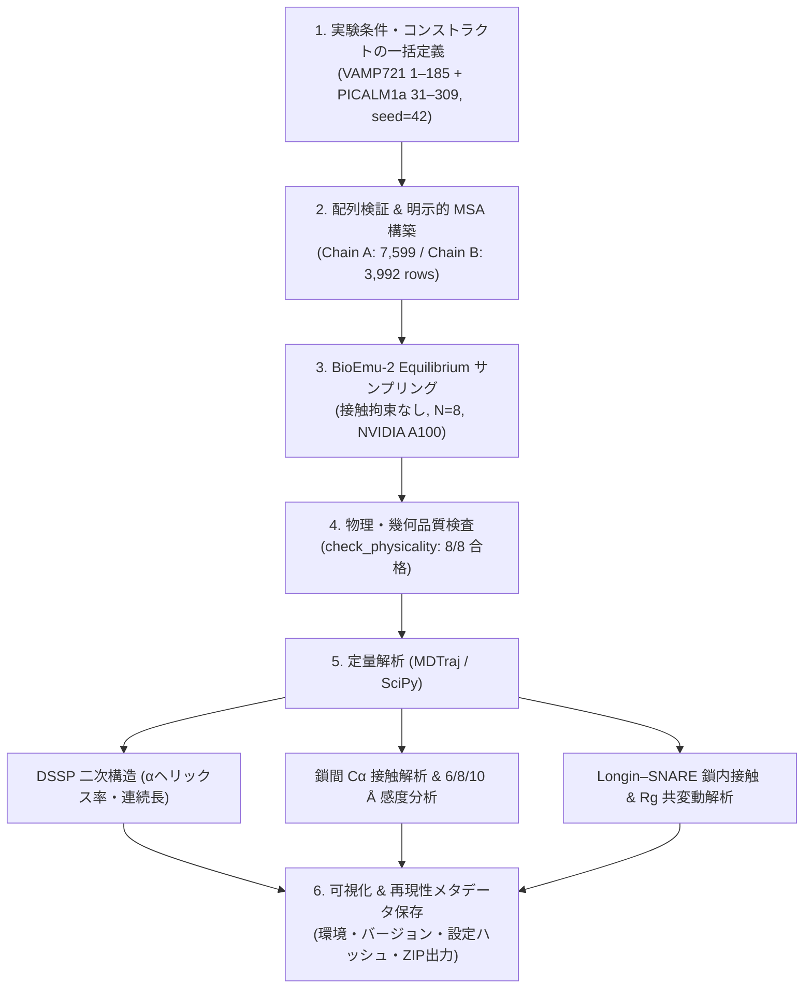

# VAMP721–PICALM1a Structural Ensemble Analysis (BioEmu-2)

日本語 | [English](README.en.md)

**拡散モデル（BioEmu-2）と Python 構造バイオインフォマティクスによる、タンパク質複合体の配座アンサンブル探索と再現可能な定量評価パイプライン。**

植物エンドサイトーシスに関わる VAMP721 と PICALM1a の複合体形成に着目し（Fujimoto et al., *PNAS*, 2020）、[BioEmu-2](https://github.com/microsoft/bioemu2) の `equilibrium` モードによる非拘束の複合体構造サンプリングから、幾何品質検査（`check_physicality`）、DSSP による二次構造定量、`SciPy cKDTree` を用いた鎖間・ドメイン間接触解析、感度分析、再現性メタデータのアーカイブまでを一貫して実装した Jupyter Notebook です。

---

## 1. 解析パイプラインの全体像

---

## 2. 実験条件と実行結果サマリー

実行ノートブック：[VAMP721_PICALM1a_BioEmu2_Complex_Equilibrium_学習版_v2.ipynb](VAMP721_PICALM1a_BioEmu2_Complex_Equilibrium_%E5%AD%A6%E7%BF%92%E7%89%88_v2.ipynb)

| 項目 | 設定・結果 |
| :--- | :--- |
| **対象複合体** | Chain A: VAMP721 (`WT 1–185`, 185 aa) / Chain B: PICALM1a (`ANTH 31–309`, 279 aa) — 計 464 残基・3,736 原子 |
| **モデル・実行環境** | `bioemu2 0.1.0rc0`, `PyTorch 2.13.0+cu130`, NVIDIA A100-SXM4-40GB (Google Colab) |
| **サンプリング設定** | `mode="equilibrium"`, `N=8`, `seed=42`, 事前接触拘束なし, 明示的 MSA 使用 |
| **物理・幾何品質検査** | `check_physicality` 合格：**8 / 8 フレーム** |
| **VAMP721 SNARE領域 (136–185) DSSP `H` 率** | **平均 70.2%**（中央値 68.0%、範囲 62.0%–82.0%） |
| **最長連続 αヘリックス長** | 各フレーム `[23, 33, 21, 23, 29, 31, 23, 15]` 残基（**8 / 8** フレームで 10 残基以上） |
| **鎖間 Cα 接触ペア数 (< 8 Å)** | 各フレーム `[84, 104, 103, 92, 81, 110, 81, 80]` ペア（6 Å / 8 Å / 10 Å の感度分析も実施） |
| **VAMP721 単独 Rg（回転半径）** | 平均 **26.25 Å** |

> **単独結果との参考比較**：同一領域（VAMP721 136–185）の事前計算（単独 `equilibrium` 100 構造）における DSSP `H` 率は **9.1%**、今回の複合体 8 構造では **70.2%**（参考差 `+61.1%`）でした。ただし標本数・実行条件が異なる探索的比較であり、生体内の結合効果や自由エネルギーを推定するものではありません。

---

## 3. 主要な可視化結果

### ① SNARE 領域の αヘリックス形成率と鎖間接触頻度

VAMP721 の SNARE 領域（136–166 残基付近）において、高い DSSP `H`（αヘリックス）頻度と、周期的な鎖間 Cα 接触（< 8 Å）の重なりが観察されました。

### ② 結合界面の 2 次元コンタクトマップ

全合格フレームを通じた残基ペア単位の接触頻度（PICALM1a 側は天然配列の残基番号へマップ済み）を可視化し、繰り返し現れる界面候補領域を定量的に把握できるようにしています。

### ③ 鎖間接触数と Longin–SNARE 鎖内接触のフレーム間共変動

鎖間接触（横軸）、VAMP721 の Longin（1–110）–SNARE 間の鎖内接触（縦軸）、および SNARE の αヘリックス率（色）をフレーム単位で同時プロットしています（構造群内の相関観察に限定し、結合順序や因果関係は仮定しません）。

---

## 4. データサイエンス・再現性設計で工夫した点

* **入力コンストラクトの事前検証**：参照野生型（185 aa）と別入力候補（194 aa）の残基差分、および PICALM1a 断片番号から天然配列残基番号への対応付けをコード上で明示的に検証。
* **カットオフ依存性の確認（感度分析）**：鎖間 Cα 接触について 8 Å 単一基準に依存せず、**6 Å / 8 Å / 10 Å** の複数閾値で接触ペア数分布を比較。
* **任意の拡張解析と計算コスト制御**：界面埋没による SASA 低下計算をオプションフラグ（`RUN_OPTIONAL_SASA`）で切替可能とし、初回検証と本解析を分離。
* **完全な再現性メタデータ保存**：設定値・入力配列ハッシュ・GPU/Python/パッケージバージョン・出力 CSV・構造ファイルを一括で ZIP アーカイブ化。

---

## 5. 科学的スコープと検証の前提

本ノートブックは、**文献の事実・AI による構造候補の生成・検証すべき科学的仮説**を明確に区別して設計しています。

* BioEmu-2 の生成フレームは独立した配座候補であり、物理的な時間軌跡ではありません。生成頻度から生体内の平衡存在比・結合親和性（$K_d$）・結合経路・自由エネルギーを直接決定することはできません。
* 今後の計算上の拡張としては、同一条件でのサンプル数拡大（50–100 構造）および独立シード間の再現性評価、単独系と複合体系の完全同条件比較が挙げられます。
* 実際の結合有無・二次構造変化・界面の妥当性の実証には、SPR / CD / FRET / NMR / HS-AFM / 複合体 SAXS などの独立した実験的検証が必要です。

---

## 6. 技術スタック

- **言語・実行環境**：Python 3.13, Jupyter Notebook, Google Colab (CUDA / GPU)
- **構造生成・分子解析**：BioEmu-2, PyTorch, MDTraj (DSSP / SASA / Rg), py3Dmol
- **数値計算・可視化**：NumPy, pandas, SciPy (`cKDTree`), Matplotlib

## 参考文献・公式ドキュメント
- Fujimoto et al., *PNAS* (2020), PMID: [32968023](https://pubmed.ncbi.nlm.nih.gov/32968023/)
- [BioEmu-2 Official Repository](https://github.com/microsoft/bioemu2)
